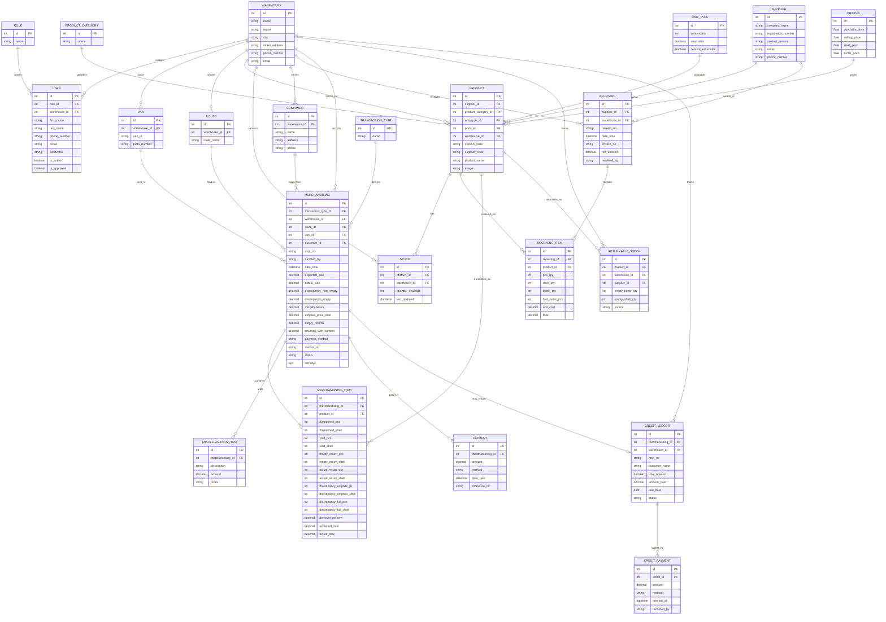

# Team-Coke ERD Draft

This draft is based on the current backend domain model and is trimmed to the core business flow.

Use this as the working ERD for:
- warehouse and van load operations
- agent mobile app planning
- Figma screen planning
- backend API refinement later

## Recommended files

I prepared two DBML files for `dbdiagram.io`:
- `ERD_DBML_PANEL.dbml`
  Use this first for panel, thesis, adviser, and client presentation.
- `ERD_DBML_CORE.dbml`
  Use this when you want something closer to the current backend structure.

If you only choose one for presentation, use `ERD_DBML_PANEL.dbml`.

## Core idea

`Merchandising` is the main transaction header.

It supports both:
- `Warehouse` transactions
- `Van Load` transactions

`MerchandisingItem` stores the per-product movement inside each transaction.

## Recommended core ERD

## Mobile agent app scope

For the phone app, you do not need every table on day one.

Focus on these:
- `User`
- `Warehouse`
- `Van`
- `Route`
- `Product`
- `Stock`
- `Merchandising`
- `MerchandisingItem`
- `MiscellaneousItem`
- `Payment`
- `ReturnableStock`

## Suggested business modules

For ERD presentation, divide the system into these modules:

1. Master Data
- Warehouse
- User
- Role
- Supplier
- Van
- Route
- Product Category
- Unit Type
- Pricing
- Product
- Customer

2. Inventory Inbound
- Receiving
- Receiving Item
- Stock

3. Sales and Van Load
- Transaction Type
- Merchandising
- Merchandising Item
- Miscellaneous Item
- Payment

4. Returnables and Credit
- Returnable Stock
- Credit Ledger
- Credit Payment

## Recommended simplification for presentation

When you present the ERD to your client or adviser, do not start with all tables.

Start with this short story:
- Warehouse prepares stock
- Van load is released to agent
- Agent sells products on route
- Agent records sold items, returns, discrepancies, expenses, and payment
- Agent syncs back to warehouse
- System updates stock, returnables, sales, and remittance

That story matches the tables above and is much easier to explain in Figma and panel discussions.
